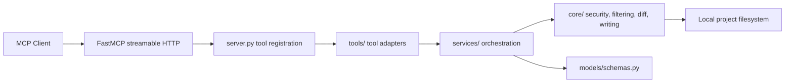
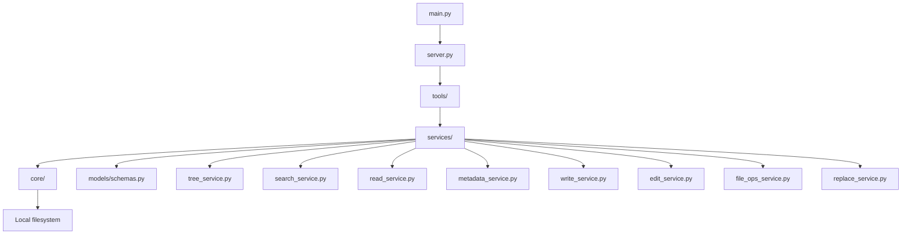
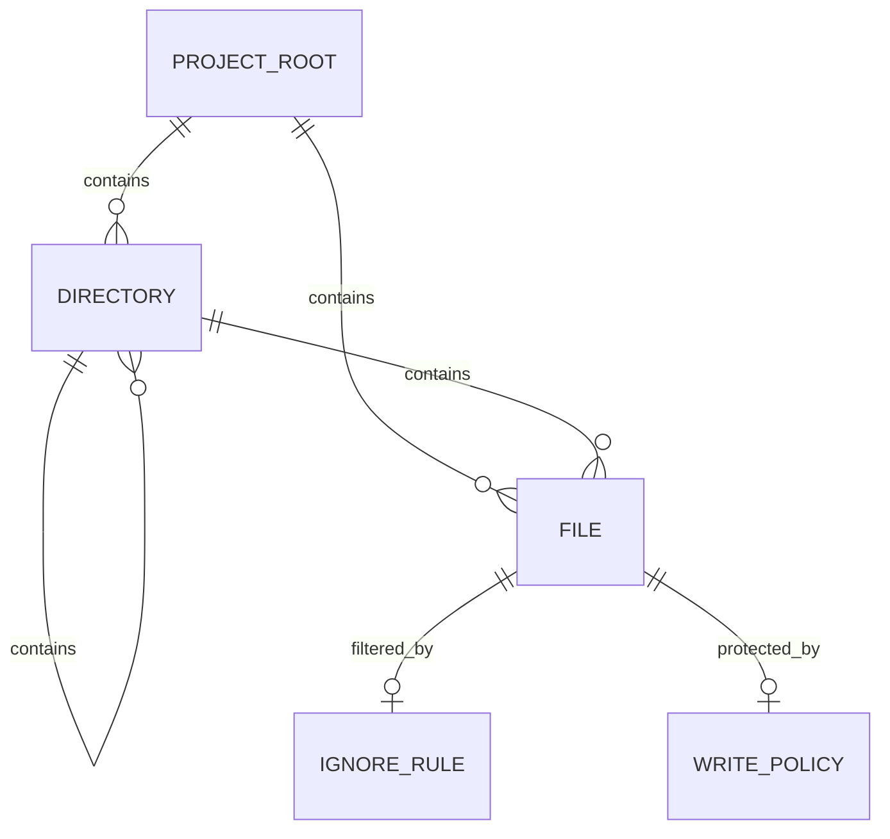
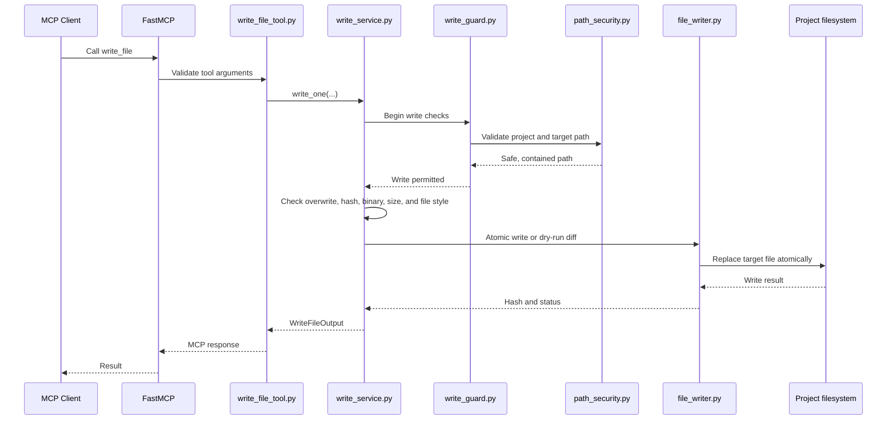
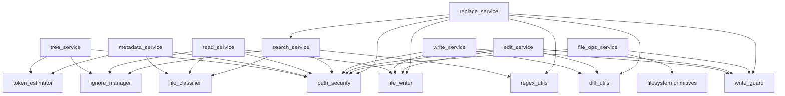
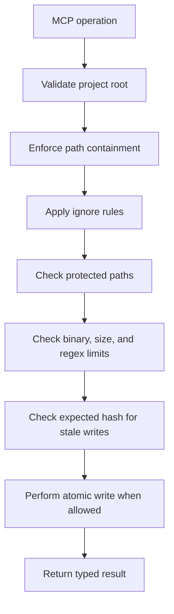

# CodeScope Backend Documentation

CodeScope is a local MCP server for inspecting and modifying project files. It exposes filesystem operations as Model Context Protocol tools through FastMCP.

## Backend Overview

Runtime entry points:

- `main.py` starts FastMCP with the configured host and port.
- `server.py` creates the `CodeScope` MCP server and registers tools.
- `config.py` controls runtime settings, including write-tool enablement and allowed roots.

## 1. Tool Map

This backend does not define application REST routes or controllers. Its public API is a set of MCP tools.

### Read Tools

| Tool | Purpose | Main inputs | Result |
| --- | --- | --- | --- |
| `list_directory_tree` | Build a filtered directory tree | Project path, depth, hidden-file option | Tree plus file and directory counts |
| `get_file_metadata` | Inspect one file | File path and project path | Size, timestamp, language, token estimate, binary status |
| `read_file` | Read a paginated text slice | File path, offset, limit | Content, line range, hash, truncation/error state |
| `read_multiple_files` | Read several files in one operation | File paths, project path, per-file limit | Per-file read results |
| `search_files` | Search filenames or file content | Query, search type, pattern, regex/case options, pagination | Matches and `has_more` status |

### Write Tools

Write tools are registered only when `ENABLE_WRITE_TOOLS` is enabled.

| Tool | Purpose | Main inputs | Result |
| --- | --- | --- | --- |
| `write_file` | Create or overwrite one file | Path, content, overwrite/create-parent flags, hash, dry-run | Hashes, diff, and write status |
| `edit_file` | Apply sequential exact-string edits | Path, edit operations, optional hash, dry-run | Edit count, diff, and new hash |
| `delete_file` | Delete one file | File path and project path | Deletion status |
| `move_file` | Move or rename one file | Source, destination, project path | Move status |
| `copy_file` | Copy one file | Source, destination, project path | Copy status |
| `replace_in_files` | Replace literal text or regex matches in multiple files | Find/replace text, file pattern, filters, regex/case options, dry-run | Per-file diffs and partial/error status |

### Git Tools

Git tools are registered when `ENABLE_GIT_TOOLS=true`. Low-write and dangerous tools also require `ENABLE_WRITE_TOOLS=true`.

| Tool | Risk Tier | Purpose | Inputs | Approval Required |
| --- | --- | --- | --- | --- |
| `git_status` | READ | Show working tree branch, tracking info, ahead/behind, changes | None | No |
| `git_diff` | READ | View diff of working tree or staged changes | Path, staged, base, max_lines | No |
| `git_log` | READ | View commit history | Limit, path, rev | No |
| `git_show` | READ | View commit details and patch | Rev, max_lines | No |
| `git_branch_list` | READ | List local branches | None | No |
| `git_branch_create` | LOW_WRITE | Create branch (optionally checkout) | Name, start_point, checkout | No |
| `git_switch` | LOW_WRITE | Switch to branch (requires clean tracked tree) | Branch | No |
| `git_merge` | DANGEROUS | Merge branch into current (auto-abort on conflict) | Branch | Yes (preview + elicit/code) |
| `git_revert` | DANGEROUS | Revert a commit (creates undo commit) | Commit SHA | Yes (preview + elicit/code) |
| `git_restore` | DANGEROUS | Discard uncommitted changes in paths (backup ref created) | Paths | Yes (preview + elicit/code) |
| `git_commit` | DANGEROUS | Stage non-protected changes and create commit (author-signed) | Message, paths | Yes (preview + elicit/code) |
| `git_push` | DANGEROUS | Push branch commits to remote repository (e.g. GitHub) | Remote, branch, set_upstream | Yes (preview + elicit/code) |
| `confirm_action` | DANGEROUS | Execute previewed action with console approval code | action_id, approval_code | Yes |

### Automated Verification Tools

Verification tools are registered when `ENABLE_VERIFICATION_TOOLS=true`. The model can only execute named checks, never arbitrary shell commands.

| Tool | Risk Tier | Purpose | Inputs |
| --- | --- | --- | --- |
| `list_checks` | READ | List authorized checks from `.codescope.toml` or auto-detected | None |
| `run_check` | EXECUTE | Execute a single named check | Name |
| `run_all_checks` | EXECUTE | Execute multiple or all checks | Names, stop_on_failure |

Input and output contracts are defined in `models/schemas.py`, `models/git_models.py`, and `models/verify_models.py`. Tool adapters live under `tools/` and delegate to services.

## 2. Layer Architecture

| Layer | Location | Responsibility |
| --- | --- | --- |
| Transport and registration | `main.py`, `server.py` | Start FastMCP and expose tool functions |
| Tool adapters | `tools/` | MCP-facing signatures and delegation |
| Services | `services/` | Orchestrate each file operation |
| Core safeguards | `core/` | Path checks, ignores, classification, regex limits, diffs, writes, and guards |
| Models | `models/schemas.py` | Typed request and response structures |
| Utilities | `utils/` | Logging and shared utility behavior |

There is no repository, ORM, domain-model, or database layer. Services operate on the local filesystem through core helpers.

## 3. Storage Model

The local project filesystem is the persistent data store:

- Files are accessed with `pathlib`, `open`, `os`, and `shutil`.
- There is no application database, ORM, cache server, or external storage integration.
- `.gitignore` and default ignore patterns are handled by `core/ignore_manager.py`.
- Ignore results are cached in memory by resolved project root.
- File writes use temporary files and `os.replace` in `core/file_writer.py`.
- Encoding, BOM, newline style, and existing permissions are preserved when possible.
- Tool responses are transient Pydantic models; request and result history is not persisted.

### Conceptual Filesystem Relationships

This is a conceptual model rather than a relational database schema. `IGNORE_RULE` and `WRITE_POLICY` are runtime rules, not stored tables.

## 4. Representative Request Lifecycle

The following traces a `write_file` MCP request from the client to the filesystem.

Detailed behavior:

1. FastMCP invokes `tools/write_file_tool.py`.
2. The adapter calls `services/write_service.py`.
3. `core/write_guard.py` verifies that writes are enabled, the project exists, and the project is inside `WRITE_ALLOWED_ROOTS`.
4. `core/path_security.py` rejects traversal, reserved paths, invalid roots, and disallowed symlinks.
5. Protected paths, ignored paths, binary content, oversized content, and stale `expected_hash` values are rejected.
6. Existing files require `overwrite=True`; existing encoding and newline style are detected.
7. A SHA-256 hash and unified diff are calculated.
8. `dry_run=True` returns the planned result without changing the filesystem.
9. Otherwise, `core/file_writer.py` performs the atomic write.
10. The service returns a typed `WriteFileOutput` response and logs the operation.

## 5. Service Dependency Map

Service entry points:

- `tree_service.py` handles directory traversal.
- `metadata_service.py` handles file metadata.
- `read_service.py` handles paginated and batch reads.
- `search_service.py` handles filename and content search.
- `write_service.py` handles single-file creation and overwrite.
- `edit_service.py` handles exact sequential edits.
- `file_ops_service.py` handles delete, move, and copy.
- `replace_service.py` handles bulk literal and regex replacement.

## 6. Authentication and Security Flow

There is no application-level authentication system. The backend does not implement login, token creation, JWT/OAuth validation, identity propagation, role checks, or route authorization middleware.

The default host is `127.0.0.1`, which limits exposure to the local machine by default. Security is primarily filesystem-oriented:

Important protections include:

- Project-root containment and traversal prevention.
- Optional symlink rejection.
- `READ_ALLOWED_ROOTS` and `WRITE_ALLOWED_ROOTS` (or centralized `ALLOWED_PROJECT_ROOTS`) allowlisting.
- Protected path patterns for `.git`, `.env`, keys, and certificates.
- `.gitignore` and default-ignore filtering.
- File-size and regex-complexity limits.
- Binary-file refusal for text operations.
- Expected-hash stale-write protection.
- Atomic file replacement.

The README documents optional ngrok exposure, but remote authentication, TLS, access control, and tunnel security are external deployment responsibilities.

## Test Coverage

The main architecture and security behaviors are covered by focused tests:

| Area | Tests |
| --- | --- |
| Tool registration and write gating | `tests/test_server_registration.py` |
| Path containment and symlink policy | `tests/test_path_security.py` |
| Read authorization and allowed roots | `tests/test_read_guard.py` |
| Write permissions and protected paths | `tests/test_write_guard.py` |
| File creation, overwrite, dry-run, hashes, and styles | `tests/test_write_service.py` |
| Exact edits and ambiguity handling | `tests/test_edit_service.py` |
| Delete, move, and copy | `tests/test_file_ops_service.py` |
| Bulk replacement and regex behavior | `tests/test_replace_service.py` |
| Reads and binary handling | `tests/test_read_service.py` |
| Filename/content search | `tests/test_search_service.py` |
| Directory trees and ignore rules | `tests/test_tree_service.py`, `tests/test_ignore_manager.py` |
| Atomic writes, encoding, newlines, and permissions | `tests/test_file_writer.py` |

## Deliberate Non-Features

The current codebase does not contain:

- Explicit REST route definitions.
- Controllers or request middleware beyond FastMCP transport behavior.
- A relational or document database.
- Repository or ORM abstractions.
- Application-level authentication and authorization.
- Request tracing, rate limiting, or persisted audit history.
- Production deployment configuration.
